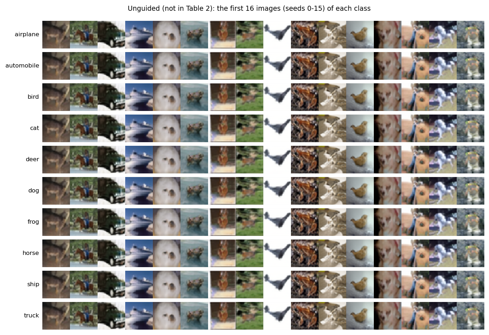
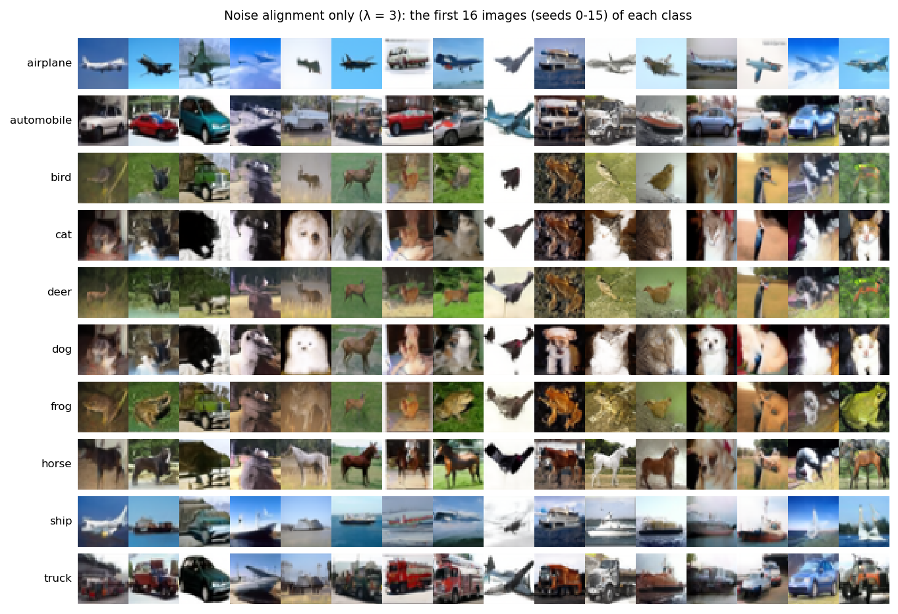
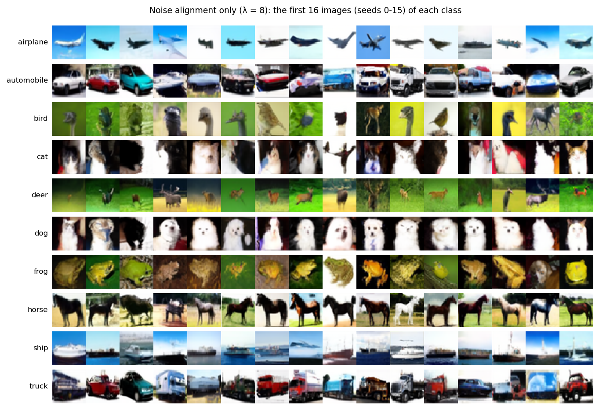
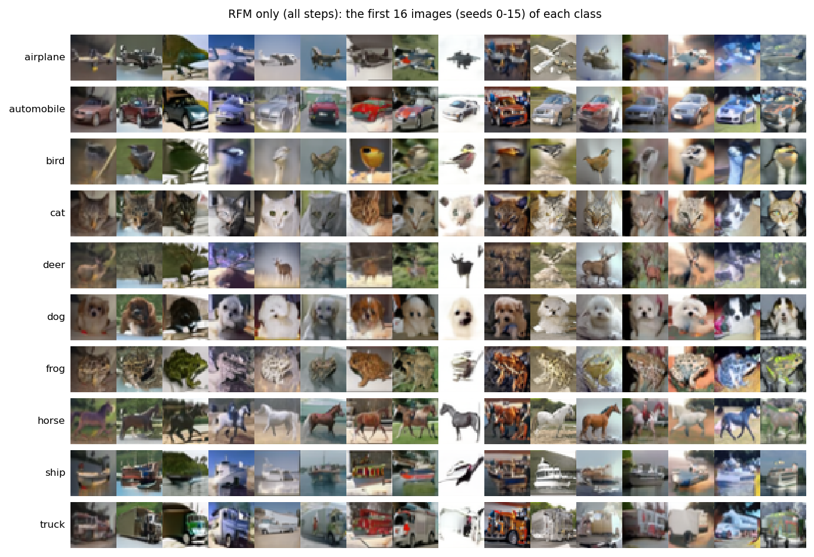
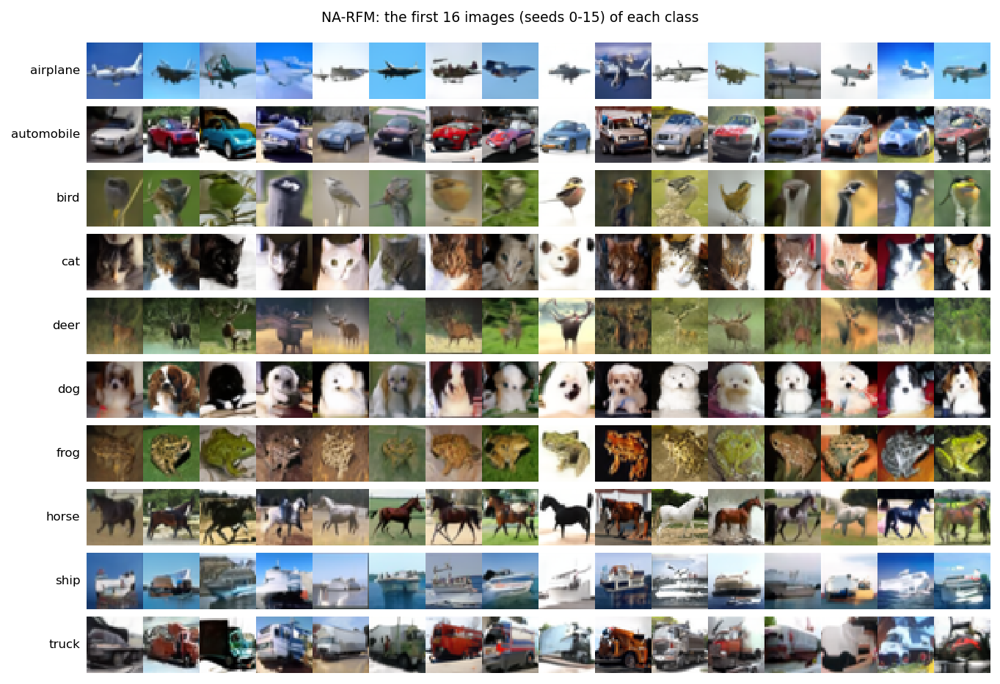
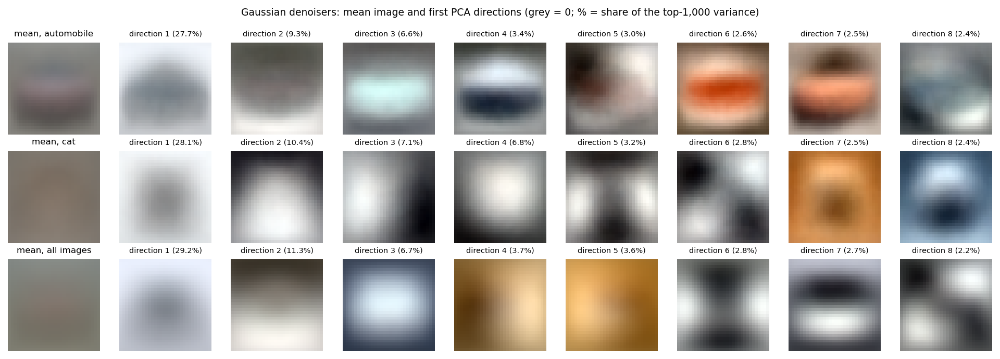
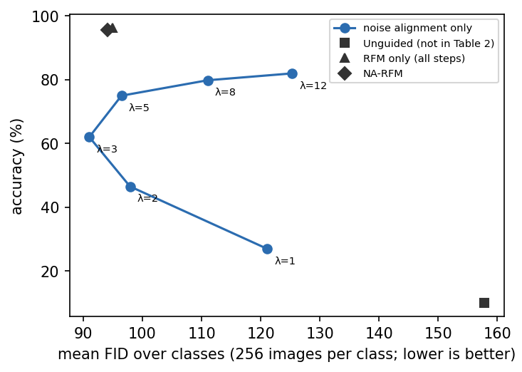
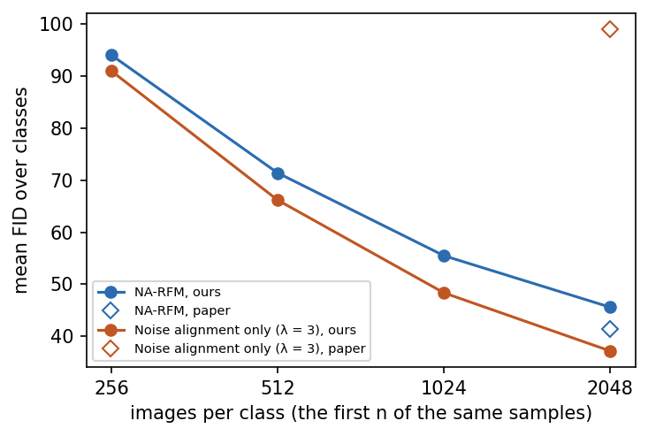

# CIFAR-10 replication of Table 2 (256 images per class, seeds 0-255, 100 DDIM steps)

Classes: airplane, automobile, bird, cat, deer, dog, frog, horse, ship, truck. GPU: NVIDIA GeForce GTX 1080 Ti.
FID: each class against its 6,000 CIFAR-10 images (train + test), averaged over classes. The paper's FID used 2,048 images per class, so its FIDs are lower than ours for that reason alone; compare our rows with each other.

| Setting | Accuracy, ours | Accuracy, paper | FID, ours | FID, paper | s / image, batch 64 (ours) | s / 16 images (ours) | s / 16 images, paper (A100) |
|---|---|---|---|---|---|---|---|
| Unguided (not in Table 2) | 10.0% | – | 157.8 | – | 0.199 | 4.1 | – |
| Noise alignment only (λ = 3) | 62.0% | 62.0% | 91.0 | 99.0 | 0.200 | 4.2 | 5.8 |
| Noise alignment only (λ = 8) | 79.8% | 80.0% | 111.0 | 120.0 | 0.200 | 4.2 | 5.8 |
| RFM only (all steps) | 96.3% | 94.8% (94.3% at 256/class) | 94.9 | 40.3 | 0.398 | 8.3 | 6.8 |
| NA-RFM | 95.7% | 96.6% (97.9% at 256/class) | 94.1 | 41.4 | 0.340 | 7.1 | 6.2 |

## Per class

Accuracy (%) / FID

| Class | RFM AUC | Unguided (not in Table 2) | Noise alignment only (λ = 3) | Noise alignment only (λ = 8) | RFM only (all steps) | NA-RFM |
|---|---|---|---|---|---|---|
| airplane | 0.931 | 11 / 159 | 77 / 99 | 96 / 131 | 97 / 106 | 99 / 98 |
| automobile | 0.967 | 6 / 172 | 60 / 73 | 70 / 84 | 100 / 63 | 100 / 66 |
| bird | 0.889 | 7 / 144 | 41 / 111 | 61 / 130 | 93 / 116 | 96 / 119 |
| cat | 0.858 | 18 / 144 | 50 / 116 | 67 / 139 | 100 / 118 | 100 / 109 |
| deer | 0.885 | 9 / 139 | 61 / 98 | 84 / 129 | 96 / 97 | 100 / 100 |
| dog | 0.859 | 12 / 153 | 60 / 101 | 77 / 133 | 98 / 101 | 96 / 107 |
| frog | 0.955 | 12 / 169 | 72 / 95 | 94 / 122 | 97 / 111 | 100 / 102 |
| horse | 0.899 | 7 / 158 | 64 / 80 | 91 / 90 | 99 / 84 | 98 / 83 |
| ship | 0.943 | 11 / 172 | 77 / 65 | 88 / 76 | 93 / 82 | 84 / 74 |
| truck | 0.943 | 7 / 169 | 58 / 73 | 69 / 77 | 90 / 70 | 83 / 83 |

RFM AUC: held-out (20%) AUC of each class's RFM classifier (class against the other nine) on block-9 features of 1,000 training images per class at σ = 0.21.

## Noise alignment only: accuracy against FID over λ

| λ | Accuracy | FID |
|---|---|---|
| 1 | 26.9% | 121.1 |
| 2 | 46.5% | 97.9 |
| 3 | 62.0% | 91.0 |
| 5 | 75.0% | 96.4 |
| 8 | 79.8% | 111.0 |
| 12 | 82.0% | 125.3 |

## At up to 2048 images per class (seeds 0-2047)

The same images throughout: each row uses the first n images of each class. The paper's FIDs are at 2,048.

| Setting | Images per class | Accuracy | FID, ours | FID, paper |
|---|---|---|---|---|
| NA-RFM | 256 | 95.7% | 94.1 | – |
| NA-RFM | 512 | 95.8% | 71.4 | – |
| NA-RFM | 1024 | 95.6% | 55.5 | – |
| NA-RFM | 2048 | 95.8% | 45.6 | 41.4 |
| Noise alignment only (λ = 3) | 256 | 62.0% | 91.0 | – |
| Noise alignment only (λ = 3) | 512 | 62.5% | 66.2 | – |
| Noise alignment only (λ = 3) | 1024 | 62.5% | 48.3 | – |
| Noise alignment only (λ = 3) | 2048 | 62.4% | 37.1 | 99.0 |

NA-RFM, per class at 2048 images (accuracy / FID): airplane 100% / 50, automobile 100% / 26, bird 94% / 56, cat 100% / 53, deer 100% / 44, dog 98% / 59, frog 99% / 46, horse 99% / 40, ship 84% / 40, truck 85% / 40.

Noise alignment only (λ = 3), per class at 2048 images (accuracy / FID): airplane 81% / 47, automobile 62% / 29, bird 41% / 44, cat 51% / 43, deer 60% / 43, dog 57% / 41, frog 67% / 36, horse 63% / 32, ship 79% / 27, truck 64% / 29.

