# When to Guide: Noise-Dependent Classifier-Free Guidance in Diffusion Models

**Evelyn Zhang** · DSC 180A, section D32 · Mentors: Yusu Wang, Qingsong Wang
Repository: <https://github.com/evelynzhang5/dsc180-diffusion-steering>

*Checkpoint draft, November 2026. Every figure and table below can be reproduced with the commands in the README.*

## Abstract

Classifier-free guidance (CFG) steers a diffusion model toward a requested class by extrapolating from its
unconditional prediction toward its conditional one with a weight w. Larger w makes samples match the request
more reliably but reduces their quality and variety. Standard practice uses the same w at every noise level,
although the sampler builds an image coarse-to-fine: the class and layout are decided at high and middle noise
levels, and fine detail at low noise. We ask whether a guidance weight that depends on the noise level can give a
better trade-off between class accuracy, sample quality (FID) and diversity than a constant weight with the same
average. As a baseline, we reproduce the constant-w trade-off with NVIDIA's pretrained EDM models on CIFAR-10
and with a small class-conditional network we train on MNIST. On CIFAR-10 (1,000 samples per w), raising w from
1 to 4 increases label accuracy from 95.5% to 98.9% while FID worsens from 31.3 to 39.0. On MNIST (5,000 samples
per w), accuracy reaches 100% at w = 2 while FID worsens from 16.0 to 61.2. Training EDM's full network on all
50,000 CIFAR-10 images for 14 GPU-hours (4.8 million images) brings FID from 412 to 50.2, against 31.2 for the
pretrained model. Sampling trajectories suggest that the
class is decided between σ ≈ 8 and σ ≈ 1, while strong guidance at low noise mostly adds saturation. Next we will
compare early-heavy and late-heavy guidance schedules with a constant baseline under matched seeds and samplers.

## 1. Introduction

### 1.1 Problem

Diffusion models generate an image by starting from pure noise and repeatedly denoising it. A class-conditional
model receives a label c and can produce images of that class. In practice, the conditional prediction alone often
gives samples that only loosely match the request. *Classifier-free guidance* fixes this without an extra
classifier: at every step the sampler evaluates the denoiser both with and without the label, and combines the two
estimates as

$$\hat D_w(x;\sigma,c) = D(x;\sigma) + w\,\big(D(x;\sigma,c) - D(x;\sigma)\big),$$

where w = 0 ignores the label, w = 1 uses the conditional model as trained, and w > 1 pushes further in the
direction of the class. Higher w raises class accuracy but makes images oversaturated and less varied, which
worsens distribution-level measures such as FID.

The weight w is usually held fixed for the whole sampling run, yet different noise levels do different jobs. At
high noise the denoiser estimate is a blur, so the class and global layout are decided there or at middle noise;
at low noise only texture and fine detail change. If guidance mainly helps by fixing the class early and mainly
hurts by distorting detail late, a schedule w(σ) could keep the accuracy benefit and reduce the quality cost.

**Research question.** Can guidance that varies with the noise level improve the trade-off between class
accuracy, sample quality and diversity compared with a constant guidance weight of the same average strength?

We will parametrize sampling progress as τ ∈ [0, 1] (τ = 0 at the highest noise, τ = 1 at the end) and compare
three schedules with the same mean weight:

| Schedule | w(τ) |
| --- | --- |
| constant | 2 |
| early-heavy | 3 − 2τ |
| late-heavy | 1 + 2τ |

These schedules are experimental choices, not known optima. The change happens only inside the sampler: no
model is retrained.

### 1.2 Related work

- **Diffusion models.** Denoising diffusion probabilistic models (Ho et al., 2020) and score-based models
  (Song et al., 2021) generate data by reversing a gradual noising process. EDM (Karras et al., 2022) separates
  the design choices of these models (noise schedule, network preconditioning, sampler) and reaches FID 1.79 on
  class-conditional CIFAR-10. We use EDM's pretrained CIFAR-10 networks and its deterministic second-order
  sampler. Flow matching (Lipman et al., 2023) describes the same family as learning a velocity field between
  noise and data; our MNIST model follows that convention.
- **Guidance.** Classifier guidance (Dhariwal & Nichol, 2021) adds the gradient of a separately trained noisy
  classifier. Classifier-free guidance (Ho & Salimans, 2022) removes that classifier by training one network with
  the label randomly dropped, then mixing its conditional and unconditional predictions.
- **Noise-dependent guidance.** Several works vary guidance during sampling. Kynkäänniemi et al. (2024) apply
  guidance only in a limited interval of middle noise levels and report better FID for EDM2 on ImageNet.
  Wang et al. (2024) compare monotone guidance schedules for text-to-image models and find that increasing
  schedules often help. CADS (Sadat et al., 2024) adds noise to the condition early in sampling to recover
  diversity. Our study differs in setting and goal: small class-conditional models on CIFAR-10 and MNIST, schedules
  with a matched average weight, and a joint report of accuracy, FID, per-class FID and diversity under matched
  seeds. Because of these prior works, we treat our schedules as a controlled comparison, not a new method.
- **Evaluation and memorization.** FID (Heusel et al., 2017) compares Gaussian fits of network features for
  real and generated images. Diffusion models trained on few images can reproduce training images
  (Somepalli et al., 2023; Carlini et al., 2023), which we observe directly in Section 2.3.

### 1.3 Data

- **CIFAR-10** (Krizhevsky, 2009): 60,000 color images at 32×32 in 10 classes (50,000 training, 10,000 test). We
  use the Hugging Face copy `uoft-cs/cifar10` at a fixed revision. The pretrained EDM networks were trained on the
  50,000 training images. FID uses EDM's reference statistics of those images; per-class FID (FID_class) compares
  each class's samples with that class's 5,000 training images. Label accuracy uses a pretrained ResNet-56
  classifier (94.4% on the test set).
- **MNIST** (LeCun et al., 1998): 70,000 grayscale handwritten digits at 28×28 (60,000 training, 10,000 test),
  downloaded with `torchvision`. We train on the training set and compute FID against the test set, using the
  128 features of the course's frozen digit classifier (99.3% test accuracy). This FID uses different features
  from Inception-based FID, so its values are not comparable with published MNIST or CIFAR-10 numbers.
- **Attributes.** The project studies the class label only, so it needs no extra attribute data.

All FIDs in this report use 1,000 (CIFAR-10) or 5,000 (MNIST) samples per setting. FID decreases with more
samples, so these values are only comparable with each other, not with published 50,000-sample results.

## 2. Preliminary results

### 2.1 Sampling with the pretrained EDM models (CIFAR-10)

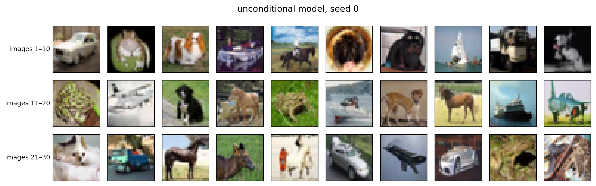
*Figure 1.* Thirty samples from the pretrained unconditional model (seed 0) cover many classes (cars, dogs, horses,
ships, frogs, planes) and are mostly recognizable objects at 32×32.

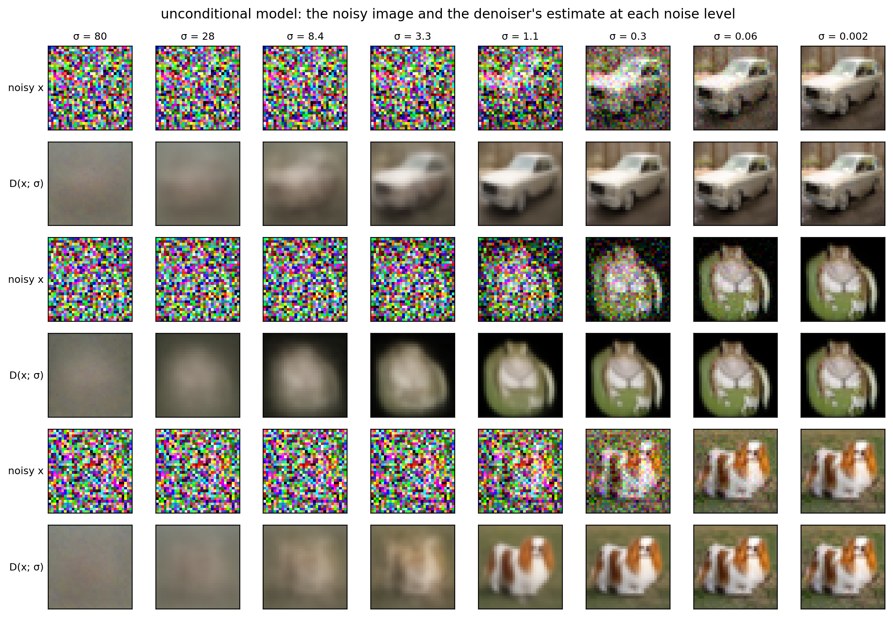
*Figure 2.* The noisy image x and the denoiser's estimate D(x; σ) for three unconditional samples. At σ = 80 and 28
the estimate is a gray average image, a centered blob appears at σ = 8.4, the object is visible at σ = 3.3, and
below σ ≈ 1.1 the estimate barely changes while the remaining noise is removed from x.

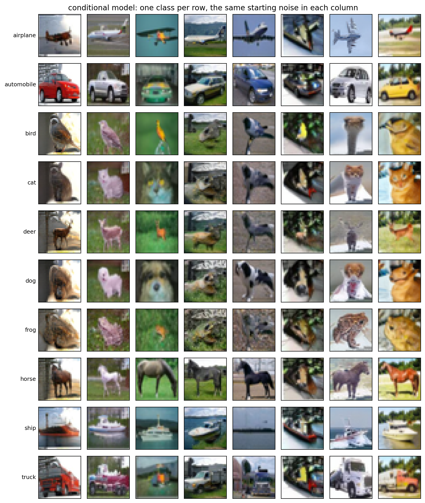
*Figure 3.* The conditional model with one class per row and the same starting noise in each column. Every row
reads as its class, while each column shares background, color and layout, so the noise fixes the composition
and the label decides what object is drawn.

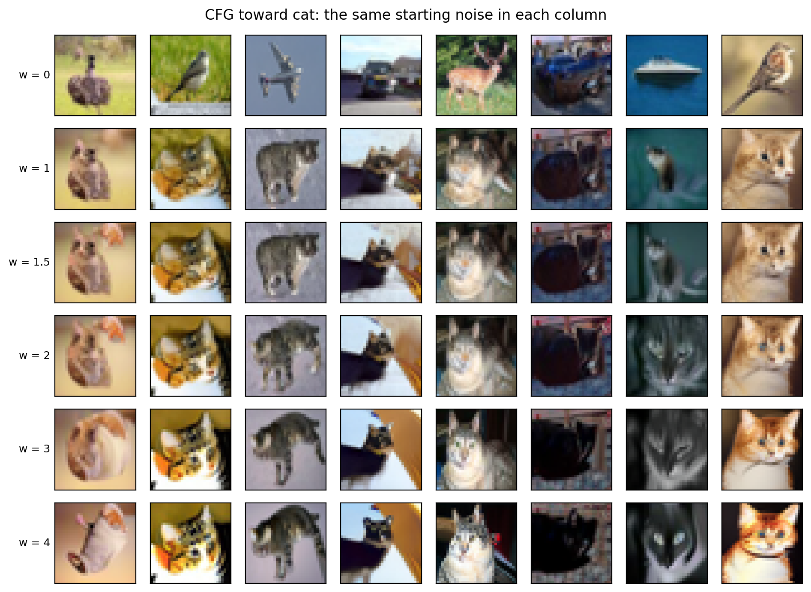
*Figure 4.* With the same starting noise in each column, w = 0 gives unrelated classes. From w = 1 every column is
a cat whose layout and colors come from the w = 0 image, and raising w to 4 mainly adds contrast and saturation.

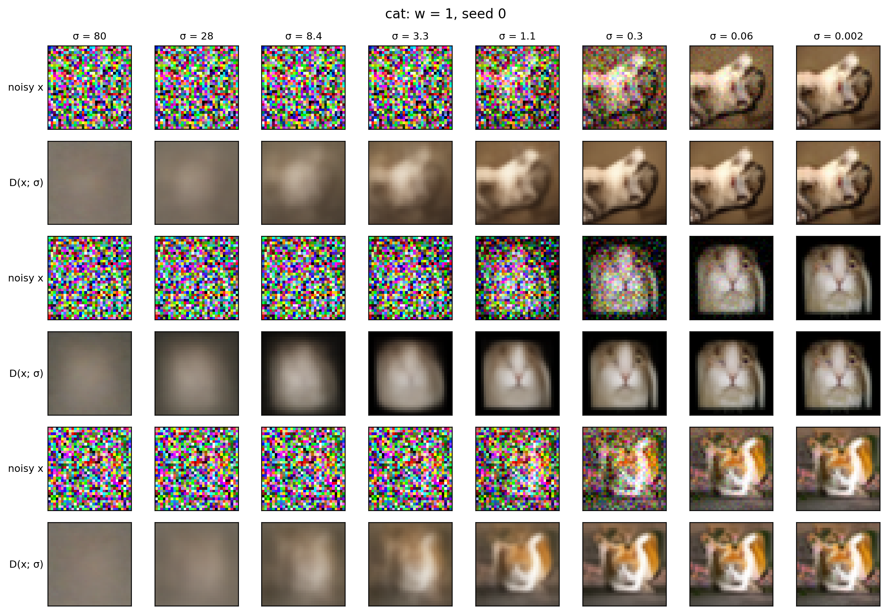
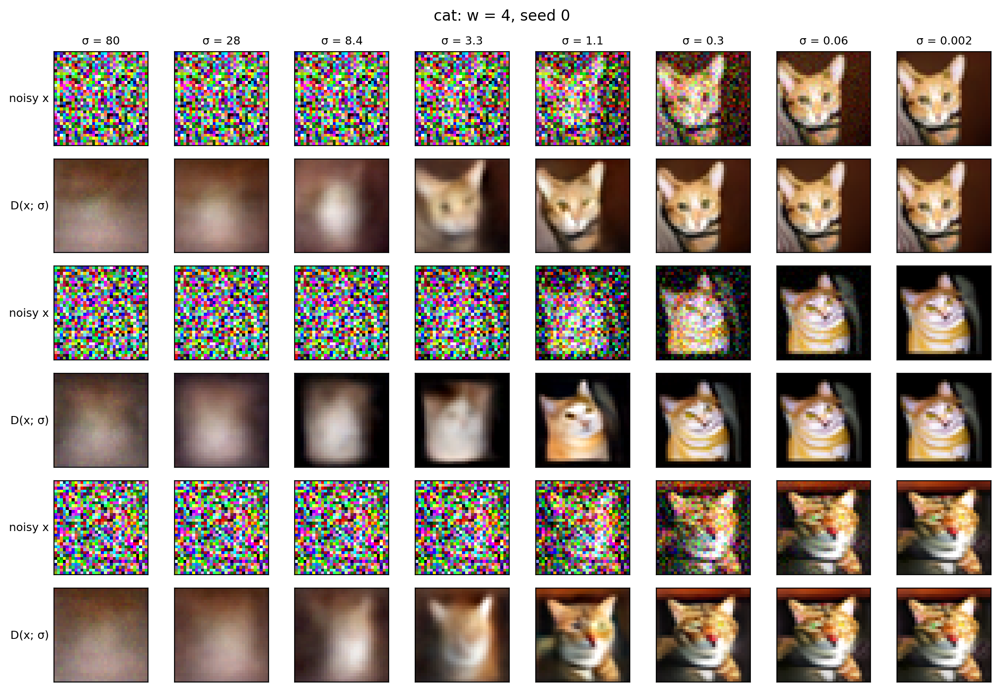
*Figures 5–6.* The denoiser's clean-image estimate D(x; σ) for three cat samples at w = 1 (top) and w = 4 (bottom).
The cat becomes recognizable at σ ≈ 1.1 for w = 1 but already at σ ≈ 3.3 for w = 4, and the estimates barely
change below σ ≈ 0.3, which suggests that guidance matters most at middle noise levels.

**Table 1.** Two-network CFG with the pretrained EDM models, 1,000 images per w, classes balanced.

| w | 0 | 1 | 1.5 | 2 | 3 | 4 |
| --- | --- | --- | --- | --- | --- | --- |
| label accuracy | 11.5% | 95.5% | 98.7% | 98.8% | 99.5% | 98.9% |
| FID | 31.19 | 31.33 | 31.44 | 33.05 | 36.03 | 39.03 |
| FID_class | – | 112.1 | 107.6 | 108.9 | 112.4 | 117.5 |

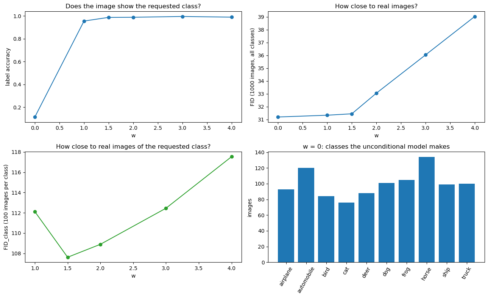
*Figure 7.* Accuracy rises quickly up to w = 1.5 and then levels off, while FID grows steadily beyond w = 1.5. The
best per-class FID is at w = 1.5, so moderate guidance gives the best balance here.

### 2.2 MNIST CFG network trained from scratch

We trained the course's MNIST U-Net (1.9M parameters) from scratch on the 60,000 training digits for 30 epochs,
replacing the label with "no label" for a random 10% of examples, and sampled with 16 DDIM steps.

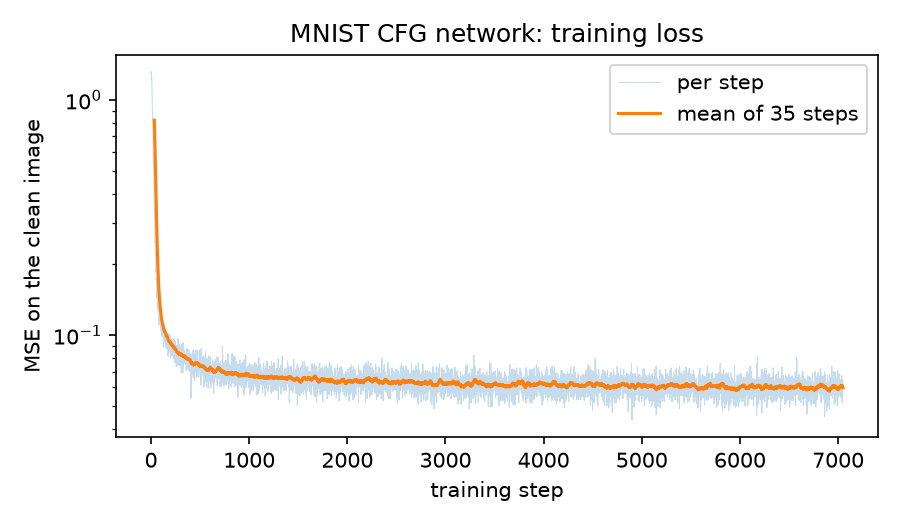
*Figure 8.* The training loss falls quickly in the first epoch and is nearly flat after about epoch 10.

**Table 2.** One-network CFG on MNIST, 5,000 samples per w. The FID of 5,000 real training digits against the test
set is 8.4, which is the lowest value to expect.

| w | 0 | 1 | 2 | 4 |
| --- | --- | --- | --- | --- |
| label accuracy | 10.2% | 97.6% | 100% | 100% |
| FID | 127.1 | 16.0 | 61.2 | 158.6 |
| FID_class | – | 48.3 | 145.2 | 308.1 |

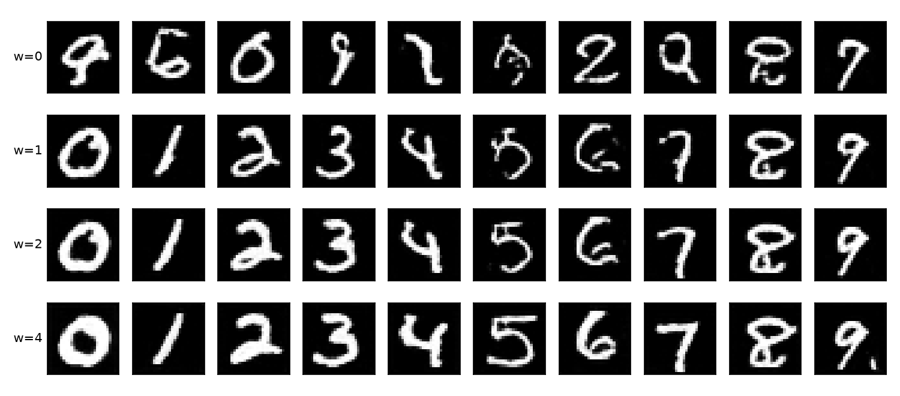
*Figure 9.* The same noise in every row: digits are correct from w = 1, and higher w makes strokes thicker and more
uniform. That explains why FID worsens even though accuracy reaches 100%.

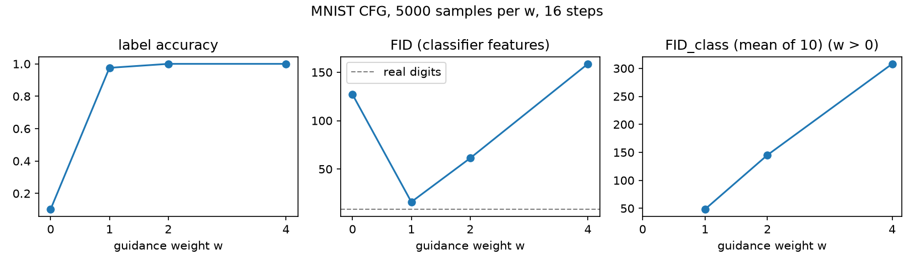
*Figure 10.* On MNIST, w = 1 already gives near-perfect accuracy and the best FID. This leaves less room for an
accuracy gain than on CIFAR-10, so on MNIST the schedules must be judged mainly on FID and diversity.

### 2.3 Training EDM's network on 100 and 1,000 CIFAR-10 images

We trained a reduced EDM network (7.0M parameters) with 10% label dropout on 100 and on 1,000 CIFAR-10 images for
20,000 updates each.

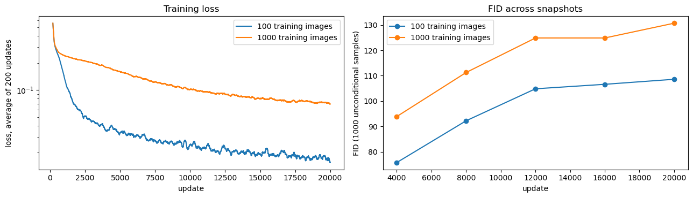
*Figure 11.* Loss keeps falling, but FID against the full training set gets worse at every snapshot. The models
increasingly reproduce their few training images instead of the full distribution.

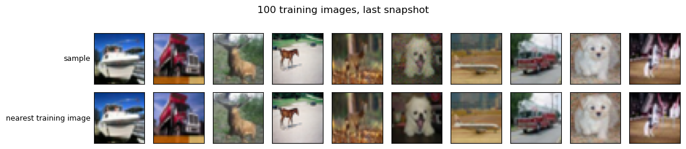
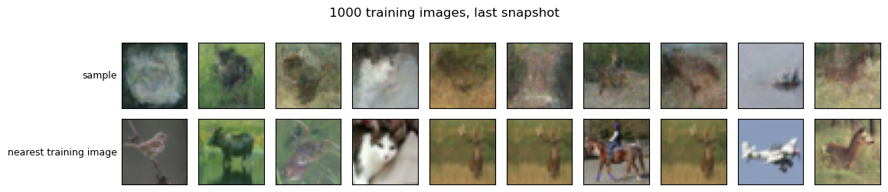
*Figures 12–13.* Each sample above its nearest training image. With 100 training images the samples are nearly exact
copies (median distance 1.3, versus 23.7 for real test images). With 1,000 images the samples are blurry and not
copies. Their median distance to the nearest training image is lower than for test images (14.0 versus 21.3), but
blurry images are close in pixel distance to many images, so this alone does not show memorization.

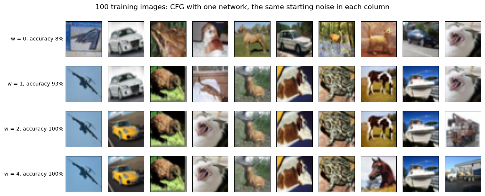
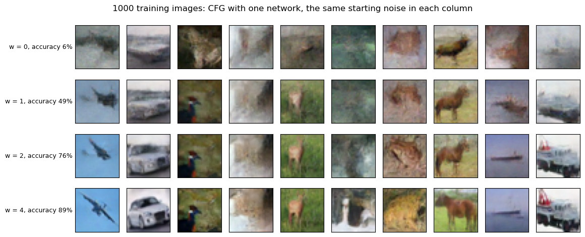
*Figures 14–15.* One-network CFG with w = 0, 1, 2, 4. On the 10 samples shown, label accuracy for the 100-image
model is 8%, 93%, 100% and 100%. For the 1,000-image model it is 6%, 49%, 76% and 89%: this model needs stronger
guidance to reach the requested class.

### 2.4 Full-data EDM training (encouraged)

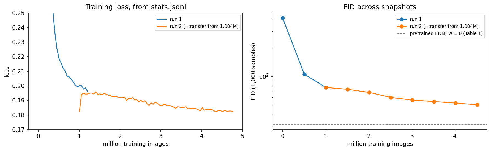
*Figure 16.* EDM's full 55.7M-parameter network trained without labels on all 50,000 CIFAR-10 images on a GTX 1080 Ti,
in two DSMLP jobs. Run 1 trained for 3.3 hours (1.205 million images). Run 2 restarted from run 1's snapshot at
1.004 million images with `--transfer` and trained for 10.6 more hours (3.764 million images), so the final network
has seen 4.77 million. `--transfer` keeps the weights but starts a fresh optimizer; run 2's loss nevertheless picks
up where run 1's left off (its first point covers only 512 images) and drifts slowly from 0.195 to 0.182, while FID
falls by a third. The loss alone understates how much the samples are still improving.

**Table 3.** FID of both runs' snapshots, 1,000 unconditional samples each (seeds from 3000), against the same
reference as Table 1. Run 2's image counts are shifted by the 1.004 million images run 1 had seen at its snapshot.

| million training images | 0 | 0.502 | 1.004 | 1.506 | 2.008 | 2.509 | 3.011 | 3.513 | 4.015 | 4.516 |
| --- | --- | --- | --- | --- | --- | --- | --- | --- | --- | --- |
| run | 1 | 1 | 1 / 2 | 2 | 2 | 2 | 2 | 2 | 2 | 2 |
| FID | 412.4 | 105.5 | 76.5 | 73.1 | 67.7 | 59.9 | 56.2 | 54.2 | 52.2 | 50.2 |

Unlike the 100- and 1,000-image runs in Section 2.3, whose FID rises as they memorize, FID here falls at every
snapshot: with all 50,000 images the network cannot memorize and learns to generalize. After 4.5 million training
images it is at FID 50.2, still well above the pretrained unconditional model (FID 31.2 at w = 0 in Table 1, also
with 1,000 samples), which EDM trained on 200 million images, and still falling by about 2 points per half million
images.

## 3. Next steps

1. Add a schedule option w(τ) to both samplers (EDM on CIFAR-10, the lab sampler on MNIST), with τ following the
   sampler's σ ordering.
2. Compare constant, early-heavy and late-heavy schedules on the same checkpoints, sampler, step count, seeds
   and class balance. Report accuracy, FID, FID_class and a diversity measure for each.
3. Add a limited-interval schedule (guidance only at middle σ) to connect with Kynkäänniemi et al. (2024).

## References

- Carlini, N., et al. (2023). Extracting training data from diffusion models. *USENIX Security Symposium*.
- Dhariwal, P., & Nichol, A. (2021). Diffusion models beat GANs on image synthesis. *NeurIPS*.
- Heusel, M., et al. (2017). GANs trained by a two time-scale update rule converge to a local Nash equilibrium.
  *NeurIPS*.
- Ho, J., Jain, A., & Abbeel, P. (2020). Denoising diffusion probabilistic models. *NeurIPS*.
- Ho, J., & Salimans, T. (2022). Classifier-free diffusion guidance. arXiv:2207.12598.
- Karras, T., Aittala, M., Aila, T., & Laine, S. (2022). Elucidating the design space of diffusion-based
  generative models. *NeurIPS*. arXiv:2206.00364.
- Krizhevsky, A. (2009). Learning multiple layers of features from tiny images. Technical report, University of
  Toronto.
- Kynkäänniemi, T., et al. (2024). Applying guidance in a limited interval improves sample and distribution
  quality in diffusion models. *NeurIPS*.
- LeCun, Y., Bottou, L., Bengio, Y., & Haffner, P. (1998). Gradient-based learning applied to document
  recognition. *Proceedings of the IEEE*.
- Lipman, Y., Chen, R. T. Q., Ben-Hamu, H., Nickel, M., & Le, M. (2023). Flow matching for generative modeling.
  *ICLR*. arXiv:2210.02747.
- Sadat, S., et al. (2024). CADS: Unleashing the diversity of diffusion models through condition-annealed
  sampling. *ICLR*.
- Somepalli, G., et al. (2023). Diffusion art or digital forgery? Investigating data replication in diffusion
  models. *CVPR*.
- Song, Y., et al. (2021). Score-based generative modeling through stochastic differential equations. *ICLR*.
- Wang, X., et al. (2024). Analysis of classifier-free guidance weight schedulers. *TMLR*. arXiv:2404.13040.
